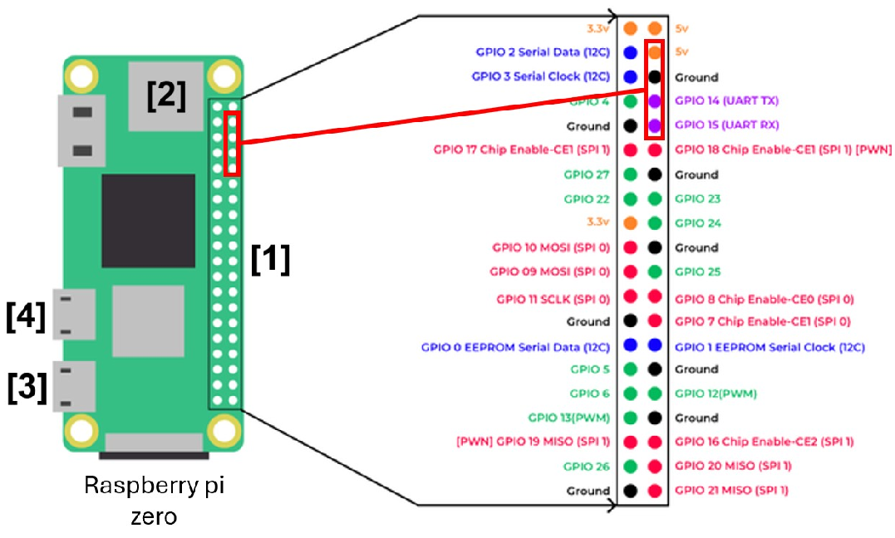
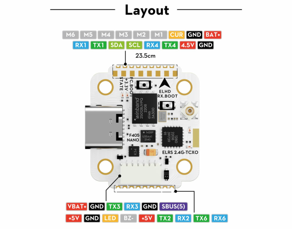
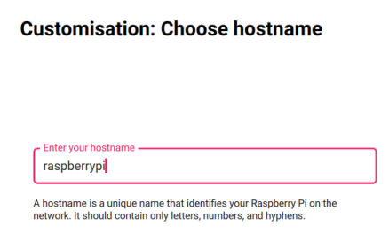
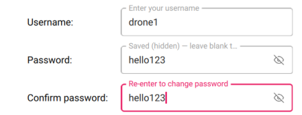
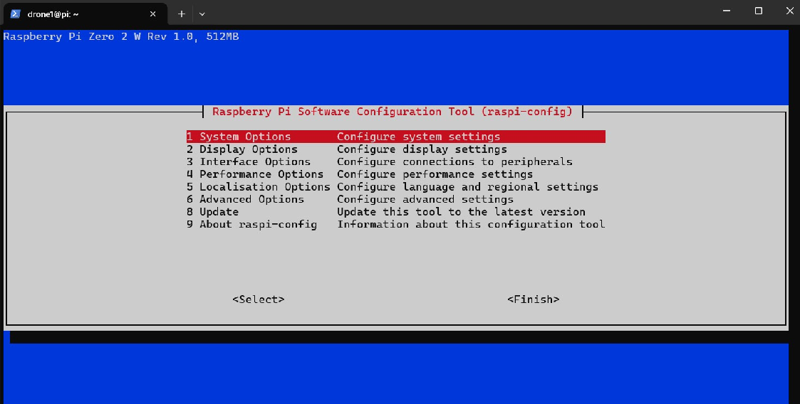

# Step 05 - Raspberry Pi Setup and Relay

This step covers configuring a **Raspberry Pi Zero 2 W** as an onboard companion computer for the drone.

The Raspberry Pi acts as a communication bridge between the ground station and the IndiFlight flight controller. It receives external positioning data through the network and forwards that information to the flight controller through a UART serial connection.

The drone can be manually flown without the Raspberry Pi, as demonstrated in Step 04. However, the Raspberry Pi becomes important for future autonomous flight experiments, including position control and research involving geometric or reinforcement-learning-based controllers. It also enables position and orientation data received from the motion-capture system to be logged in the flight controller's Blackbox.

In this project, a **Raspberry Pi Zero 2 W** running **64-bit Raspberry Pi OS** was used.

Alternatively, [TU Delft's Racebian](https://github.com/tudelft/racebian), a Raspberry Pi companion-computer setup developed for flight-controller integration, can be considered. In this project, only the Raspberry Pi OS was used.

The required header pins and the flight-controller UART wiring were prepared earlier in [Step 02.6](Step_02_Soldering_and_Assembly.md).

## 1. Identify the Raspberry Pi Zero 2 W connections

Before starting, familiarise yourself with the Raspberry Pi Zero 2 W.



The important connections for this project are:

- **GPIO header [1]:** used for power and UART communication with the flight controller.
- **MicroSD card slot [2]:** contains the operating system and installed software.
- **PWR IN [3]:** micro-USB power input.
- **USB [4]:** micro-USB data port, which can also be used for USB gadget communication.

The Raspberry Pi will eventually use four connections to the flight controller:

| Raspberry Pi | Flight controller |
|---|---|
| 5 V | 5 V |
| GND | GND |
| GPIO 14 / UART TX | UART RX2 |
| GPIO 15 / UART RX | UART TX2 |



## 2. Install Raspberry Pi OS

The operating system must first be installed on a microSD card.

Download and install **Raspberry Pi Imager**:

[Raspberry Pi Imager](https://www.raspberrypi.com/software/)

Insert a microSD card (atleast 16GB) into the computer using a suitable card reader or make use of an adapter.

Open Raspberry Pi Imager and select:

1. **Raspberry Pi Device:** Raspberry Pi Zero 2 W
2. **Operating System:** Raspberry Pi OS (64-bit)
3. **Storage:** The microSD card

Make sure that the correct storage device has been selected, as writing the operating system will overwrite its existing contents.

### 2.1 Configure the operating system

Before writing the operating system, Raspberry Pi Imager allows several settings to be configured.

### Hostname

Choose a hostname for the Raspberry Pi. For example:



This name will later be used to connect to the Raspberry Pi over the network.

### Username and password

Create a username and a password. For example:



Remember these credentials because they are required when connecting through SSH.

### Wireless network

Enter the Wi-Fi network name and password.

The Raspberry Pi and the computer used for SSH must be able to communicate through the same network.

In this project, the laboratory network caused connectivity problems. A home Wi-Fi network or mobile hotspot was therefore used during the initial setup.

### SSH

Enable **SSH** and select password authentication.

SSH allows the Raspberry Pi to be controlled remotely through a terminal without requiring a monitor or keyboard.

Raspberry Pi Connect is not required for this setup.

### 2.2 Write the operating system

After configuring the settings:

1. Select **Write**.
2. Confirm the selected storage device.
3. Wait until Raspberry Pi Imager finishes writing and verifying the operating system.
4. Safely eject the microSD card.

> **Windows note:** Windows may ask to format the SD card after it has been written. Do not format it again. The card contains Linux partitions that Windows may not recognise.

Insert the prepared microSD card into the Raspberry Pi Zero 2 W.

## 3. Connect to the Raspberry Pi using SSH

For the initial setup, the easiest method is to connect over Wi-Fi.

Connect a suitable micro-USB power cable to the Raspberry Pi's **PWR IN** port.

Allow the Raspberry Pi to boot and connect to the configured Wi-Fi network.

Make sure the computer is connected to the same network.

Open PowerShell on Windows or a terminal on Linux/macOS and enter:

```bash
ssh username@hostname.local
```

For example:

```bash
ssh raspberrypi@drone1.local
```

When connecting for the first time, confirm the SSH host-key fingerprint after verifying that you are connecting to the intended Raspberry Pi.

Enter the password configured during OS installation.

If successful, the Raspberry Pi terminal will become accessible.

## 4. Update Raspberry Pi OS

After connecting through SSH, update the package lists and installed packages:

```bash
sudo apt update
sudo apt full-upgrade -y
```

When the updates finish, reboot the Raspberry Pi:

```bash
sudo reboot
```

The SSH connection will close during the reboot.

Reconnect using the same SSH command.

## 5. Optional: enable USB gadget communication

Normally, the Raspberry Pi is accessed through Wi-Fi.

However, it is also possible to configure the Raspberry Pi Zero 2 W to appear as a USB network device when connected directly to a computer.

This can be useful when Wi-Fi access is unavailable or unreliable.

The Raspberry Pi USB gadget project is available at:

[Official Raspberry Pi USB Gadget Repository](https://github.com/raspberrypi/rpi-usb-gadget)

On a supported Raspberry Pi OS installation where the package is available, the setup commands are:

```bash
sudo apt update
sudo apt install rpi-usb-gadget
sudo rpi-usb-gadget on
sudo reboot
```

For Windows, the USB network driver may also be required:

[USB Gadget Releases and Windows Driver](https://github.com/raspberrypi/rpi-usb-gadget/releases)

Once enabled:

1. Connect a data-capable micro-USB cable to the Raspberry Pi's **USB** port, not `PWR IN`.
2. Connect the other end to the computer.
3. Wait until the USB network device is recognised.
4. Connect through SSH using the Pi's USB network address or hostname.

> **Important:** The USB gadget connection is used for remote access. It is separate from the GPIO UART connection that communicates with the flight controller.

## 6. Enable serial communication

The Raspberry Pi communicates with the IndiFlight flight controller using UART.

To enable the serial interface, connect to the Raspberry Pi through SSH and run:

```bash
sudo raspi-config
```

This opens the Raspberry Pi configuration menu:



Navigate to:

```text
Interface Options -> Serial Port
```

When prompted, select:

```text
Would you like a login shell to be accessible over serial?
No
```

Then:

```text
Would you like the serial port hardware to be enabled?
Yes
```

The serial login shell is disabled because the UART is reserved for communication with the flight controller rather than for logging into the Raspberry Pi.

Exit the configuration menu and reboot:

```bash
sudo reboot
```

### 6.1 Verify the UART device

After reconnecting through SSH, run:

```bash
ls -l /dev/serial0
```

The output should show that `/dev/serial0` points to an available UART device, such as:

```text
/dev/serial0 -> ttyAMA0
```

or:

```text
/dev/serial0 -> ttyS0
```

The exact target depends on the Raspberry Pi's UART configuration.

The relay instructions used in this project specify a high serial baud rate of `921600`. For this reason, using the hardware-timed PL011 UART (`ttyAMA0`) is preferable to the mini UART (`ttyS0`).

### 6.2 Check the physical UART wiring

Before connecting the Raspberry Pi to the flight controller, turn them both off.

Verify the wiring prepared in Step 02:

```text
Raspberry Pi TX  -> Flight Controller RX2
Raspberry Pi RX  -> Flight Controller TX2
Raspberry Pi GND -> Flight Controller GND
Raspberry Pi 5V  -> Flight Controller 5V 
```

Make sure the connectors are correctly aligned, no pins are shorted, and the wiring cannot enter the propeller area.

Do not connect the Raspberry Pi to the flight controller until the operating system and serial configuration have been prepared.

## 7. Install the required dependencies

The IndiFlightSupport relay is written in C++ and must be compiled for the Raspberry Pi.

Install the required tools using:

```bash
sudo apt install -y git build-essential cmake
```

Also install the Python packages used by the supporting tools:

```bash
sudo apt install -y python3-pip python3-semver python3-yaml
```

## 8. Download and transfer the relay folder

The relay software is part of TU Delft's IndiFlightSupport project. However, it is not necessary to clone the entire repository onto the Raspberry Pi.

The required relay folder is provided here:

[Download the relay folder](https://drive.google.com/drive/folders/10syfrpQvwli3eLl5TzhxtMYHdanP7N2t?usp=sharing)

### 8.1 Download the relay folder

On your computer:

1. Open the Google Drive link.
2. Download the `relay` folder.
3. Extract the downloaded ZIP file if necessary.

Make sure the extracted folder contains the relay source files, including `CMakeLists.txt` and the `src` directory.

### 8.2 Transfer the folder to the Raspberry Pi

The easiest method is to transfer the folder using SCP (Secure Copy), which works over SSH.

Open PowerShell or a terminal on your computer and run:

```bash
scp -r /path/to/relay username@hostname.local:~/
```

Replace:

- `/path/to/relay` with the location of the downloaded relay folder on your computer;
- `username` with your Raspberry Pi username;
- `hostname` with your Raspberry Pi hostname.

Alternatively, a graphical SCP application such as WinSCP can be used to transfer the folder.

### 8.3 Verify the transfer

Connect to the Raspberry Pi through SSH:

```bash
ssh username@hostname.local
```

Navigate to the transferred folder:

```bash
cd ~/relay
```


The relay folder is now ready to be compiled in the next section.

## 9. Compile the relay

Create a build directory:

```bash
mkdir build
cd build
```

Configure the CMake project:

```bash
cmake ..
```

Compile the relay:

```bash
make
```

If compilation succeeds, the resulting executable should be available in the build directory.

## 10. Verify the relay serial configuration

The relay must use the same serial settings as the flight controller.

From the relay directory, inspect the serial configuration in the source code:

```bash
grep -n "serialPort\|baudrate" src/relay.cpp
```

In the configuration used for this project, the required baud rate was:

```text
B921600
```

This corresponds to **921600 baud**.

Also verify that the configured serial device corresponds to the available Raspberry Pi UART.

If the relay source code is changed, rebuild the program using:

```bash
cd build
make
```

The flight-controller UART settings and the relay serial settings must match.

## 11. Find the Raspberry Pi IP address

Run:

```bash
hostname -I
```

This displays the IP addresses assigned to the Raspberry Pi.

For example:

```text
192.168.1.42
```

Record the IP address associated with the network that will be used for communication with the ground station.

The IP address will be needed in the next step when configuring the connection between OptiTrack/Motive, the ground station, and the Raspberry Pi.

> **Note:** The IP address may change after reconnecting to another network or restarting the network connection.

## 12. Safely shut down the Raspberry Pi

Before removing power from the Raspberry Pi, use:

```bash
sudo shutdown now
```

Allow the shutdown to complete before disconnecting the power supply.

This reduces the risk of corrupting files on the microSD card.

## Expected output

At the end of this step, you should have:

- Raspberry Pi OS (64-bit) installed and configured on the Raspberry Pi Zero 2 W;
- working SSH access through Wi-Fi (and USB gadget);
- the relay compiled successfully;
- the Raspberry Pi IP address recorded.

The Raspberry Pi is now prepared for integration with the ground station and the OptiTrack motion-capture system in Step 06.